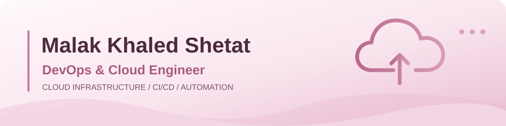
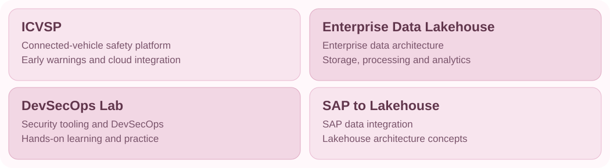

 

**☁️ Building reliable cloud infrastructure, automating workflows, and securing delivery pipelines.**

 

 

I'm **Malak**, focused on **DevOps and Cloud Engineering**, with hands-on experience in AWS networking, CI/CD workflows, repository migration, cloud data architecture, and security-focused automation.

I enjoy making infrastructure more **reliable, repeatable, and secure**.

 

 

 

### 🌸 Selected Projects

[**ICVSP**](https://github.com/malakshetat78/Graduation-Project-) · [**Enterprise Data Lakehouse**](https://github.com/malakshetat78/agm-lakehouse-architecture) · [**DevSecOps Lab**](https://github.com/malakshetat78/devsecops-lab) · [**SAP to Lakehouse**](https://github.com/malakshetat78/sap-to-lakehouse)

 

 

- Reviewed GitHub repositories using **Trivy, Checkov, Gitleaks, and Semgrep**, with remediation reports.
- Contributed to an **Enterprise Data Lakehouse** architecture.
- Configured and validated **AWS Site-to-Site VPN** connectivity.
- Migrated repositories from **Azure DevOps to GitHub** and configured CI/CD workflows.

 

**☁️ Cloud · DevOps · Automation**

